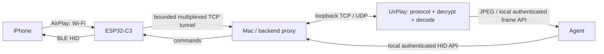

# C3 AirBridge

**用 ESP32-C3 做 iPhone Agent 的网络中继与蓝牙操作端。**

实验项目。C3 负责小缓冲 TCP/UDP 转发和蓝牙鼠标键盘，AirPlay 握手、解密和视频解码留在网关。**已实测经 C3 转发 iPhone 画面，并通过 C3 打开微信、选择中文候选词和发送明确授权的消息。** 新增千问视觉 Agent、本机控制台与服务监督；具体实机验收和稳定性边界见 [验证记录](docs/validation.md)。

日常连接手机、打开控制台、本机服务安装和火山引擎迁移方法见 **[部署与使用说明](docs/deployment.md)**。

## 架构



首轮拓扑：iPhone、C3、Mac 均连接同一个可互通的局域网。C3 主动连接 Mac；手机在“屏幕镜像”选择 **C3 AirBridge**。该入口的 A 记录指向 C3，不是绕过 C3 直连 Mac。C3 原样转发加密视频，不保存完整图像、不做视频解码、不运行模型。

区别于普通 NAT：后端需要向手机发送时序包，因此这里使用有状态双向代理，在后端改写 SETUP 中的端口，并通过独立 UDP 通道回到手机。C3 每帧最多 4096 字节，最多 8 条数据通道和 6 个监听端口。控制消息的 plist 解析只发生在 Mac。

## 当前范围

| 部分 | 已实现 | 验证范围 |
|---|---|---|
| C3 固件 | ESP-IDF 6.0.1，Wi-Fi STA、USB 配网、TCP/UDP 中继、状态上报 | 见验证记录 |
| 蓝牙输入 | 鼠标移动、点击、按住/释放、滚轮、原始键盘 usage | 安全配对、移动、按下/释放点击、计算器键盘输入通过；滚轮/拖动待测 |
| 后端 | 设备鉴权、有限队列、回压、通道限制、UDP 回程 | 本地协议/集成测试 |
| AirPlay 适配 | 从真实 UxPlay 复制发现记录、SETUP 端口改写 | 已收到 iPhone 经实板 C3 转发的画面 |
| 视觉 Agent | 千问兼容接口、截图决策循环、有限动作集、鼠标视觉校准、中文拼音选词、任务停止 | 实机验收见验证记录 |
| 运维与控制台 | 本机鉴权控制台、LaunchAgent、日志轮转、子服务重启、画面主动刷新 | 本机部署；USB 备用观察明确标注 |
| 远程云端 | 提供 Agent systemd 配置与 SSH 加密隧道迁移说明 | 服务器登录失败时按用户要求先本机部署；没有暴露 C3 明文公网入口 |

## 安装与首轮实验

需要 ESP32-C3（4 MB Flash）、数据线、2.4 GHz Wi-Fi、Python 3.11+、ESP-IDF **6.0.1**。iPhone 与 Mac 允许在局域网互通。供电方式不影响协议设计。

```bash
python3 -m venv .venv
.venv/bin/pip install -e .
.venv/bin/python -m unittest discover -s tests -v
```

### 1. 备份与烧录

**烧录会替换 MicroPython 和板上应用。先将完整 Flash 读出到仓库以外的私有路径。备份可能包含凭据，不要提交。**

```bash
# 激活本机 ESP-IDF 6.0.1 环境后：
python -m esptool --port PORT read-flash 0 ALL /private/path/original-flash.bin
cd firmware
idf.py set-target esp32c3
idf.py build
idf.py -p PORT flash
```

无需整片擦除。恢复原状态：在确认芯片和串口后，将自己的完整备份写回偏移 `0`。不要使用其他开发板的备份。

### 2. 先测转发链路

```bash
# 生成本机 token，Wi-Fi 密码通过交互输入，不会写进代码：
.venv/bin/c3-provision --port PORT --host MAC_LAN_IPV4
# 另开终端：
.venv/bin/c3-airbridge --host MAC_LAN_IPV4 --echo
```

也可以使用本机配置页：

```bash
.venv/bin/c3-provision --port PORT --host MAC_LAN_IPV4 --web
```

打开它输出的 `127.0.0.1` 随机路径，在本机填写 Wi-Fi。Wi-Fi 配置及 token 写入板子 NVS。token 保存在 `.local/token`，默认不提交。本实验固件没有配置 Flash/NVS 加密。

使用 `scripts/hardware_probe.py --device DEVICE_LAN_IPV4` 通过 C3 的 7100 端口做二进制回环。**echo 模式不是 AirPlay 接收器。**
加 `--stream` 可测试连续流，默认逐块往返用于字节完整性与延迟检查。

### 3. 接入真实 AirPlay

安装 [UxPlay](https://github.com/FDH2/UxPlay) 及 GStreamer，参照其官方平台说明。macOS 不一定有名为 `uxplay` 的 Homebrew formula；可用 `scripts/build_uxplay.sh` 从固定提交编译，需先安装 `gstreamer libplist openssl@3 pkgconf`。

```bash
# macOS：构建固定版本并应用本机 Bonjour 补丁
bash scripts/build_uxplay.sh
# 视频 TCP 17100，控制 TCP 17000；时序/音频 UDP 16000~16002
bash scripts/run_uxplay.sh -vs 'jpegenc ! multifilesink location=.local/frame.jpg'
# 另开终端，捕获真实接收器只对本机发布的 TXT/身份：
.venv/bin/python -m airbridge.discover --local-only --name C3-Upstream
# 停掉 echo 进程，启动实际代理：
.venv/bin/c3-airbridge --host MAC_LAN_IPV4 --config .local/relay.json --frame-file .local/frame.jpg
```

在 macOS 上可用 `scripts/run_uxplay.sh` 启动无窗口接收器，脚本隔离所需 GStreamer 插件，避免全局 gst-python 插件扫描挂起。要产生截图：

```bash
bash scripts/run_uxplay.sh -vs 'jpegenc ! multifilesink location=.local/frame.jpg'
# 后端启动时加：--frame-file .local/frame.jpg
```

后端的 `GET /frame` 返回最近 5 秒内的完整 JPEG，需要同样的 Bearer token；不存在、未写完或过期的图片不会作为新观察返回。截图和录制仅保存在被忽略的 `.local/` 下。每次重启 UxPlay 后，应重新运行发现脚本并重启后端，以更新接收器身份。

C3 自动重连并更新监听与发现配置。iPhone 打开控制中心 → 屏幕镜像 → **C3 AirBridge**。macOS 必须使用补丁后的 UxPlay 和 `--local-only` 发现：如果 upstream 同时在局域网广播相同身份，iPhone 会合并入口，甚至经 IPv6 直接连接 Mac。验证时必须同时观察 C3 字节计数和 UxPlay 的 loopback 连接，不能仅凭菜单名称或看到画面判断经过 C3。Linux 的普通局域网发现不加 `--local-only`，其发现隔离尚未验证。

先验证发现，再验证配对/SETUP，再验证真实画面。后端遇到未映射端口或不支持的控制流会拒绝并记录错误，不会假装连接成功。它仍是实验适配，尤其需要观察时序回程、iOS 版本和丢包恢复。

### 4. 蓝牙操作接口

iPhone 配对 **C3 AirBridge**，打开“设置 → 辅助功能 → 触控 → 辅助触控”。如请求配对码，查看本机串口日志（不会提交日志）。
最初版本的 GATT 名称可能被 iOS 缓存为 `nimble`；若 Mac 能扫描到而手机列表缺失，可在 iPhone 的“设置 → 蓝牙”内关闭再打开蓝牙。不要清空整个 NVS，以免删除 Wi-Fi 配置。

后端只在 `127.0.0.1:8766` 提供管理 API，要求 `Authorization: Bearer TOKEN`：

| 请求 | JSON |
|---|---|
| `GET /status` | 无 |
| `GET /frame` | 无；需要配置 `--frame-file`，未开始投屏时不可用 |
| `POST /hid` | `{"op":"move","x":10,"y":0}` |
| `POST /hid` | `{"op":"click"}` |
| `POST /hid` | `{"op":"press"}` / `{"op":"release"}` |
| `POST /hid` | `{"op":"scroll","wheel":-1}` |
| `POST /hid` | `{"op":"key","usage":4,"modifiers":0}`（美式键盘 a） |

每次移动限制 -127~127，Agent 分步移动并通过画面校准。返回 `ok` 仅说明 HID 调用被接受，不证明屏幕已成功点中。中文通过拼音和鼠标选词实现，不是 HID 直接传输 Unicode；不提供锁屏绕过。
默认短 `click` 已在打开微信、聊天列表和中文候选词选择中实测。较长的 `press`/`release` 可能触发长按菜单，不能一概当作普通点击。系统快捷键受 iOS 版本和全键盘控制配置影响。

## 限制与后续

- LAN 版隧道是带 token 的明文 TCP，不直接暴露公网。远端部署先实现 TLS/VPN/认证与连接恢复。
- 第一版只支持一个设备、一个 iPhone，会话断开时释放输入状态；Wi-Fi 与 BLE 共享射频，实际带宽需测量。
- 只处理现有 UxPlay 支持的 AirPlay 镜像控制形式，不承诺所有 AirPlay 版本；加密控制、chunked 控制消息不支持。
- UDP 包最多 4096 字节，超出应拒绝/丢弃而非拼凑视频。没有将任意“视频包”直接交给模型的接口。
- 暂不实现 C3 SoftAP、蜂窝回传、通用上网路由或独立电池电源电路。
- 运行内存、持续吞吐、AirPlay 实机和 BLE 共存指标，是实验结论的必要条件。
- 本轮有五分钟持续画面样本，但继续运行出现过中继重连及较低的内存余量，当前不保证长期稳定。

## 来源与许可

项目受 **[ESP32 iPhone Agent by Henry Yuan](https://github.com/onehumanbeing/esp32-iphone-agent)** 启发。本仓库没有复制其 GPL AirPlay 实现；AirPlay 接收由单独安装运行的 UxPlay 提供。

自编代码 MIT；两个 ESP-IDF GAP 帮助文件使用其原有 CC0/Unlicense 授权；UxPlay 补丁单独采用 GPL-3.0，见 [THIRD_PARTY.md](THIRD_PARTY.md)。
