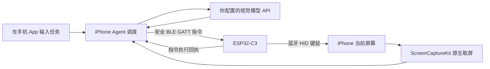

# C3 Agent

用 **iPhone + ESP32-C3** 执行自然语言手机任务。iPhone 原生取屏、调用视觉模型、调度动作；C3 通过蓝牙输出鼠标和键盘。运行时不依赖 Mac、AirPlay、局域网中继或自建 Agent 服务器。

要求 **iOS 27+**，开发安装需要 **Xcode 27+**。这是实机实验项目，不能保证所有 App、所有任务或无限期后台运行都成功；当前验收范围见 [validation](docs/validation.md)。



C3 的 USB 线负责供电、刷机和可选开发诊断。**C3 不支持原生 USB 键鼠**，也不接收或解码视频。接手机供电需要匹配的供电线/转接器；使用电池或独立 USB 供电也可以。

## 使用

1. 给刷入新版固件的 C3 供电。首次在 iPhone 蓝牙中配对 **C3 Agent**；升级旧固件的记录可能仍叫 C3 AirBridge/nimble。若要求配对码，输入 `123456`。这是实验固件的固定配对码，不应在不可信环境中开放配对。
2. 在 iPhone **设置 → 辅助功能 → 触控 → 辅助触控**中打开辅助触控，并打开**辅助功能 → 键盘 → 全键盘控制**。
3. 打开 **C3 Agent App**，确认“C3 已连接 · 安全蓝牙”。填写支持图像输入和 JSON 动作输出的 OpenAI-compatible HTTPS API 地址、模型名和 API Key，保存。
4. 在任务框输入任务，点**开始任务**，在系统提示中确认**共享整个屏幕**，然后轻点弹层外空白处回到 App，任务会自动开始。保持手机解锁，任务运行中避免手动改变页面。
5. App 自己观察、调用模型并通过 C3 执行输入。回到 App 查看结果或点**停止任务**；点**结束共享**会同时停止任务和取屏。

画面按需发送给所配置的模型服务。Key 保存在 iPhone Keychain；最新图像和开发诊断只保存在 App 私有目录。没有“先录一整段视频，再上传”的步骤。静态屏幕可能暂时没有新帧；需要观察时 App 通过小幅鼠标移动触发更新，未拿到新画面就停止输入。

## 构建和安装

固件使用 ESP-IDF **6.0.1**。Mac 上可能同时连接 C3 和 S3，**端口名会变化，不能靠旧端口选板**。先根据 USB 系统信息和已独立确认的芯片身份，在私有 `.local/c3-device.json` 中绑定你的 C3：

```json
{"chip":"esp32c3","usb_serial":"YOUR_VERIFIED_C3_USB_SERIAL"}
```

本项目开发机已经完成私有绑定，不公开设备身份。工具通过 IOKit 检查 USB 序列号，再打开端口；不匹配会立即拒绝，避免重置或刷写同时开发的 S3。

```sh
. /path/to/esp-idf/export.sh
python3 scripts/device_guard.py
python3 scripts/flash_c3.py
```

不要执行 erase-flash；普通升级保留蓝牙配对信息。确认选择的是 C3 的端口。

iOS：打开 `ios/C3Agent.xcodeproj`，选自己的 Signing Team 和 iPhone，运行。默认 Bundle ID 为保留旧测试 App 数据而沿用的 `com.zhaoyang.c3screenprobe`，可换成自己的唯一标识。也可使用：

```sh
python3 scripts/install_ios.py --device YOUR_IPHONE_UDID --team YOUR_TEAM_ID
```

可选 `--bundle-id`、`--key-file /private/path/key.txt`、`--base-url`、`--model`。不要把密钥文件放进仓库。首次蓝牙权限、配对和屏幕共享需要系统授权；App 不尝试绕过锁屏或授权。

开发签名的有效期取决于你的 Apple 开发者账户；过期后需重新签名安装。App 没有使用私有输入接口、越狱或后台音频保活。

## 代码结构

- `ios/C3Agent/`：任务界面、ScreenCaptureKit、模型客户端、动作校验、视觉鼠标定位、CoreBluetooth 回执和后台调度。
- `firmware/main/`：BLE HID + 加密 GATT 指令服务，固定大小指令队列，不启用 Wi-Fi。
- `scripts/`：安装和可选 USB 串口诊断；正常手机任务不使用它们。
- `tests/`：模型动作边界与键盘编码检查。
- [协议说明](docs/protocol.md)、[验收记录](docs/validation.md)、[旧版迁移](docs/migration.md)。

模型动作有参数校验、步骤/时间上限、重复动作检测和停止机制。鼠标采用相对位移与视觉反馈，不能直接把屏幕像素当作 HID 绝对坐标。无法定位指针或获取当前画面时会停止点击。除非任务明确授权，不发送消息、购买、删除数据或修改安全/账号设置。

**harness 在手机 App 内**：记录动作是否真正执行、对变化中的画面重新决策、处理指令回执、限制定位失败恢复次数，并以另一轮当前截图校验检查完成结果。它不是另一台必须在线的电脑。现阶段鼠标悬停定位仍有失败，尚未通过稳定的完整任务验收，不能把链路接通等同于任意任务可用。

## 旧版

主线 1.0 已移除 Python 后端、UxPlay、AirPlay 中继、Wi-Fi 配网、云后端部署和旧监督进程。旧实现保留在 Git 标签 [`legacy-airplay-v0.2`](https://github.com/ZhaoYangGG/c3-airbridge/tree/legacy-airplay-v0.2)，无需复制一份旧架构进新版。仓库名保留 `c3-airbridge` 以维持链接。

[MIT License](LICENSE) · [Third-party notices](THIRD_PARTY.md)
