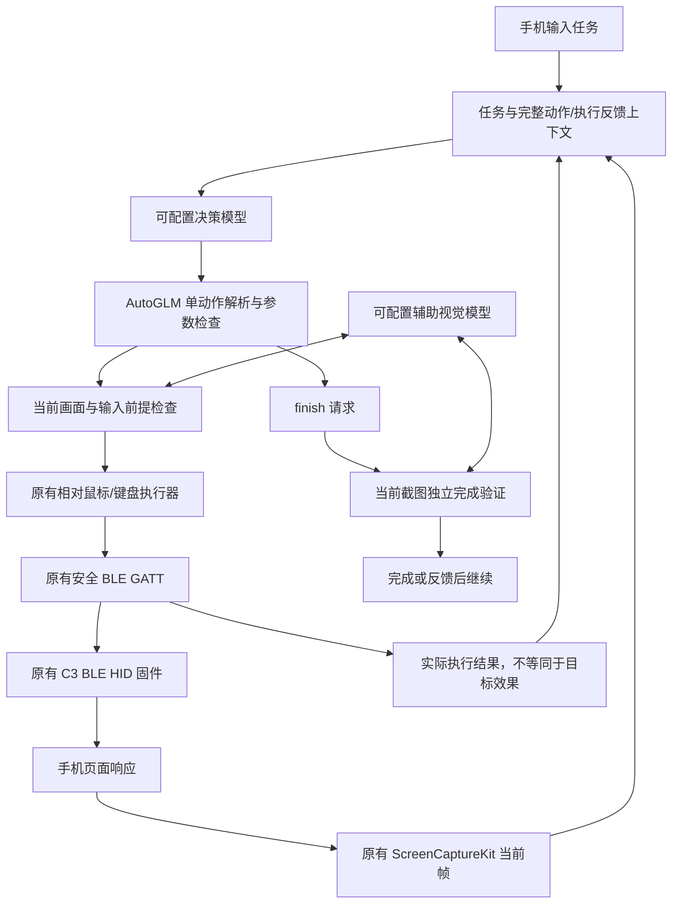

# Open-AutoGLM Swift/C3 核心

更新：2026-10-24。上游固定为
[zai-org/Open-AutoGLM](https://github.com/zai-org/Open-AutoGLM/tree/86f55382982fb054e8fc98ca80609dff8a2cdc3c)。
这是其决策循环、上下文生命周期与动作协议的原生 Swift 适配，不是把 Python
包或 WDA 安装到手机，也不代表继承了上游完整能力和评测成绩。

## 流程与不变的链路

取屏配置、蓝牙服务 UUID、GATT 数据格式、C3 固件、USB 用途和 C3/S3
隔离规则均未更换。手机仍是唯一调度器；没有新增电脑/服务器运行时。

## 核心迁移与扩展

- 原来的单轮自定义 JSON 决策与最近 12 条动作摘要由 AutoGLM 动作协议和
  多轮对话替代。每个任务保留原始目标、动作和真实执行反馈，历史图像不重复
  上传；每轮只有当前图像。没有额外叠加第二套规划器。
- 决策用 OpenAI-compatible chat/completions 的流式输出，不强制 JSON。
  支持服务忽略 stream 并返回完整 JSON 响应的情况。必须有正常终止信号；
  length 截断、流中断、无效语法不能被视为完成。
- 解析器只接受一次 do/finish 调用及字面量参数，不执行模型生成的 Python。
  拒绝重复参数、越界坐标和尾随第二个动作。坐标按上游执行器的 1000 分母
  转为现有执行器使用的 0–1 坐标。
- 保留旧输入状态核验、计算器 OCR、独立完成核验、画面变化检查和停止释放。
  不兼容动作以 NOT EXECUTED 反馈给模型，连续三次不兼容时停止。
- 默认 60 步、硬上限 100 步；15 分钟时限保留。重复动作只有在画面也近似
  不变时才累加无进展次数，避免将有效的连续滚动直接判为重复失败。
- 不显示或记录完整推理文本；上下文保留动作和执行反馈。Note 可存入任务
  历史，但不是跨任务永久记忆，也不是外部工具调用。

## 模型可组合，并不绑定 AutoGLM 权重

| 角色 | API 要求 | 使用方式 |
| --- | --- | --- |
| 决策模型 | HTTPS OpenAI-compatible、图像输入、文本流式输出，能按 AutoGLM 协议输出 do/finish | 可使用 AutoGLM，也可填写能遵循该协议的其他视觉模型；需单独验证兼容性 |
| 辅助视觉 | HTTPS OpenAI-compatible、图像输入、支持 JSON 对象输出 | 定位鼠标、检查悬停、检查输入状态、验证任务完成 |

可以配置 AutoGLM 决策 + Qwen 辅助视觉，也可以反过来使用其他兼容决策模型。
两栏填写同一服务/模型/Key 也是允许的，但该模型必须同时兼容动作和 JSON
请求；不能认为 AutoGLM 专用端点一定支持辅助视觉的 JSON 输出。
这只是组合能力设计与离线请求检查，不是对任意具体模型的实机兼容认证。

决策栏提供上游 README 中的智谱配置示例作为默认值：
`https://open.bigmodel.cn/api/paas/v4` / `autoglm-phone`。
Key 留空，由用户自行填写，也可替换整个服务地址与模型名。
辅助视觉保留旧 URL、模型和 Keychain 账号，不自动把旧 Key 复制到决策服务。
运行任务时禁止通过配置页面或开发 bootstrap 修改模型配置。

### 千问官方端点的首轮配置建议

用户当前端点为 `https://maas.qianwenaiapi.com/compatible-mode/v1`，
与[千问官方兼容接口文档](https://platform.qianwenai.com/docs/api-reference/toolkitframework/openai-compatible/overview)一致。
建议先对照 **qwen3.8-max 决策 + qwen3.8-flash 辅助视觉**；辅助定位或读数
不稳时，用 qwen3.7-plus 做质量对照。该选择依据公开模态/能力定位，尚不是
本手机的实机排名。两栏均须填写对应服务的 Key，不由开发工具导入凭据。

按[官方思考模式文档](https://platform.qianwenai.com/docs/developer-guides/text-generation/thinking)，
这些模型默认开启思考。当前 App 对已识别的千问官方端点与已知混合模式
Qwen 型号发送 `enable_thinking=false`，用于逐步 GUI 操作的低延迟基线。
辅助 JSON 请求也走同一策略；不向 AutoGLM 或未知供应商擅自添加该参数。
不要使用 auto 路由做验收，以免实际模型或模态变化导致结果不可比较。

## 动作兼容表

| 上游动作 | 当前 Swift/C3 行为 | 差异/限制 |
| --- | --- | --- |
| Tap | 视觉定位后发送原有 click | 仍是相对鼠标；不能保证任意目标一次命中 |
| Swipe | 原有鼠标按住拖动 | 不是原生触屏滑动，效果取决于 App |
| Type / Type_Name | 支持字符的 ASCII/拼音物理键盘输入，沿用输入预检 | 不自动清空、不直接注入 Unicode、不自动收键盘；中文需要点击候选 |
| Launch | 只发已验证的 SEARCH 键，反馈明确说明尚未启动 App | 后续由模型观察 Spotlight、输入应用名并点真实图标 |
| Double Tap | 定位一次后连续两次短点击 | 新适配，尚未实机验收 |
| Long Press | 定位后保持按钮约 3 秒、释放 | 用已有零位移指令维持按下，避免固件 1.5 秒空闲自动释放；尚未实机验收 |
| Wait | 等待 0–5 秒 | 超范围拒绝 |
| Note | 将 message 保留在本次任务上下文 | 不发送 HID，不声称调用外部服务 |
| Home / Back | 明确返回不支持及可见 UI 替代方法 | 不能直接使用 WDA 系统命令；模型需点击返回按钮或辅助触控 |
| Call_API | 明确拒绝；提示用现有截图/历史作答 | 没有可调用的外部 API 工具，不能静默当成功 |
| Take_over / Interact | 停止并显示接管/补充信息原因 | 当前没有任务暂停后续跑；用户处理后可新开任务 |
| Tap 带 message | 停止并显示模型的确认请求 | 不自动点击 |
| finish | 触发旧有独立当前截图完成验证 | 模型声明或 HID ACK 均不是成功依据 |

显式 C3 扩展：`do(action="Key", key="SEARCH", modifiers=[])` 与
`do(action="Scroll", wheel=-3)`，以及 `do(action="Clear")`。
Clear 先独立检查可见的搜索/文本字段焦点，再发送 Command+A、Backspace；
不能用于计算器。下一次 Type 仍需检查清空结果。这些是适配扩展，不是上游标准动作。
完整能力提示位于 `ios/C3Agent/AgentPrompt.txt`，避免把 Android/WDA 的
自动清空、直接启动等假设带入当前设备。

## 耗时和验收

App 私有 `status.json` 包含 decision_calls、vision_calls、agent_core，
job.metrics 记录每一步 total_seconds、decision_seconds、vision_seconds 和
execution_seconds_including_pointer_vision。执行阶段可能调用辅助视觉，
所以最后一项与 vision_seconds 有重叠，不能直接相加。

鼠标归位已到边界时可能没有新像素，归位阶段不再强制等待一次自发重绘；
第一次向外移动仍必须取得移动后的新帧。到达目标后也移除了重复等待，
点击前仍检查新鲜度与页面变化。没有改动固件和相对鼠标加速度算法。
辅助 JSON 输出截断或不是有效对象时最多重试一次，重试增加输出额度；
无效输出不会变成动作，HTTP/网络错误仍停止。异常响应只留在手机私有诊断。
框架更换不代表点击必然提速。
后续必须在同一手机、同一取屏与输入链路上，对照任务成功率和这些耗时。

离线测试覆盖原生动作、C3 能力映射、恶意/截断动作、SSE 分片、完整目标
与执行反馈保留、只携带当前图像和独立模型请求构造。它们不等于真实模型
或 iPhone 任务验收；实际状态见 [validation.md](validation.md)。
