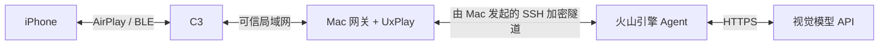

# 部署与日常使用

## 已有设备如何使用

1. C3 插 USB 供电；数据线接 Mac 可保留诊断能力。独立电池也能供电，但当前接收网关仍需要 Mac。
2. C3、iPhone、Mac 在同一个可互通的局域网。**C3 必须连接 2.4 GHz Wi-Fi**，iPhone 和 Mac 可以连接同一局域网的 5 GHz。访客隔离、AP 隔离会阻止通信。
3. iPhone 设置 → 蓝牙，连接 **C3 AirBridge**。旧记录可能曾叫 `nimble`。首次配对需要人在手机上确认；已配对后保留记录，不要每次忽略设备。
4. 设置 → 辅助功能 → 触控 → 辅助触控，保持开启。全键盘控制可辅助导航，但 iOS 不同版本的快捷键不同；当前通过蓝牙鼠标点击和键盘输入，不依赖 C3 USB 模拟鼠标。
5. 控制中心 → 屏幕镜像 → **C3 AirBridge**，不要选择 C3-Upstream。手机保持解锁，Mac 保持联网。
6. 双击桌面的 **C3 AirBridge.command**，打开本机控制台。连接状态、画面来源和最近任务结果都在页面上。
7. 输入明确任务，例如“打开计算器，计算 12+34，看到 46 后停下”，点击“开始任务”。发送消息的任务须写明联系人和准确内容。
8. “立即停止 / 松开按键”会取消任务并向 C3 释放鼠标、键盘。任务有步骤和时间上限，不能确认结果时显示阻塞原因，不冒充完成。

中文输入目前采用**蓝牙键盘输入拼音 → 蓝牙鼠标点击候选词**。空格有时会提交拉丁拼音，不能当作中文转换成功；微信回车会发送，模型须先检查输入框和聊天标题。

安装后的配置、截图、日志和 Key 位于 `~/Library/Application Support/C3AirBridge/.local/`，目录权限 700，Key 文件权限 600。项目目录的调试 `.local/` 也被 Git 忽略，不发布到公开仓库。每次视觉任务会把必要的屏幕截图发送给配置的模型 API。Key 只由后端读取，控制台不会返回 Key。

## 本机安装

安装 Python 3.11+、GStreamer、UxPlay 构建依赖，按 README 完成 C3 配网和初次 AirPlay/BLE 配对。在项目目录执行：

```bash
python3 -m venv .venv
.venv/bin/pip install -e .
bash scripts/build_uxplay.sh
.venv/bin/python scripts/install_local.py \
  --bridge-host MAC_LAN_IPV4 \
  --uxplay-binary .local/uxplay/build/uxplay \
  --api-key-file /private/path/key
```

默认使用千问 OpenAI 兼容接口、`qwen3.5-plus`；可用 `--base-url`、`--model` 更改。配置参考 [agent.example.json](../config/agent.example.json)。接口格式见[千问视觉文档](https://help.aliyun.com/zh/model-studio/vision/)。

USB 备用观察是可选诊断能力：另外安装 `pymobiledevice3`，并向安装器传入 `--usb-observer-udid DEVICE_UDID`。它仅截图，不通过 USB 启动应用、点击、输入或粘贴；所有交互仍经 C3。控制台会明确标注 **USB 备用观察**，不能把这个画面算作 C3 视频恢复。

自动在手机界面重新选择投屏默认关闭；可用 `--auto-reconnect` 显式启用有限次数恢复。当前机器保持关闭，因为早晨检查时手机已锁屏，避免后台重复尝试。解锁手机后，手动选择一次屏幕镜像即可开始日常任务。维护阶段曾另用 USB 打开系统蓝牙设置页，属于连接诊断，未用于正常 Agent 点击/输入。

安装器将运行时安装在 `~/Library/Application Support/C3AirBridge/`，避免后台进程依赖桌面目录的隐私授权；建立用户级 LaunchAgent `com.yang.c3-airbridge`，登录 Mac 后启动。监督进程负责接收器、LAN 中继和 Agent；子服务退出会重启，日志有大小限制，并阻止 Mac 空闲休眠。合盖、退出登录、断电仍会影响服务。

```bash
# 查看系统服务状态
launchctl print gui/$(id -u)/com.yang.c3-airbridge
# 重启整套服务（会中断当前投屏/任务）
launchctl kill SIGTERM gui/$(id -u)/com.yang.c3-airbridge
# 停止服务
launchctl bootout gui/$(id -u)/com.yang.c3-airbridge
```

后台使用三个本机/局域网端口：

| 端口 | 用途 | 暴露范围 |
|---|---|---|
| 8765/TCP | C3 主动连接网关 | 可信 LAN，带 token 的实验协议 |
| 8766/HTTP | 中继、画面、HID 管理接口 | 仅 127.0.0.1，Bearer 鉴权 |
| 8871/HTTP | Agent 控制台与任务 API | 仅 127.0.0.1，登录 Cookie 或 Bearer 鉴权 |

桌面启动器读取 `.local/agent-url` 中的私有登录链接。不要公开链接或将 8765、8766、8871 直接做公网端口映射。Mac 局域网 IP 变化后应更新 C3 的后端地址，建议在路由器给 Mac 保留 DHCP 地址。

## 为什么画面会“丢失”

需要区分以下情况，详见 [验证记录](validation.md)：

- **画面静止**：iPhone AirPlay 可能只发送变化区域，静止页面的 JPEG 可长时间不更新。网关不会伪造新时间；任务需要观察时，先轻移鼠标触发画面变化，再要求实际收到新 JPEG。
- **通道关闭竞态**：CLOSE 与反向 DATA 会交叉。C3 和后端都用有限的已关闭通道记录识别在途数据，避免误断整条隧道。
- **反向 UDP 任务未回收**：关闭传输时同步取消泵任务、删除映射，避免重连后不断积累。
- **蓝牙显示已连接但无法输入**：异步 HID 连接事件可能晚于加密事件到达，旧代码会把已完成的安全状态清掉。固件改为查询实时连接描述符，分别上报连接、加密和认证状态，不放宽认证门槛。
- **UxPlay 视频线程退出**：上游在视频 TCP EOF 路径可能遗留旧描述符或失去接收线程。单独的 GPL 补丁关闭描述符并触发完整连接复位，避免只剩“控制连接还在线”。
- **C3 瞬时内存压力**：限制 Wi-Fi 动态缓冲数量，报告最大连续空闲块、最低 heap、重连次数和在途数据计数。是否改善需以持续实机数据判断。

监督进程会先小幅往返移动鼠标，要求实际新帧。单凭旧帧不能断定断流：只有持续大量媒体流入而解码仍停止才自动重启接收器，避免静止页面触发误重启。若显式启用 USB 诊断恢复且蓝牙仍在线，可有限次数尝试通过手机界面重新选择屏幕镜像。首次配对、生物识别、锁屏、Wi-Fi 改变或重连失败仍可能需要本人操作；不能保证系统级操作永远无需人介入。

## 以后迁移到火山引擎

本轮服务器 SSH 端口可达，但现有登录认证被拒绝，因此按用户指定的备用方案部署在 Mac，没有更改服务器上的其他服务。

建议迁移 **Agent 决策服务**，将 AirPlay 发现、解码和 C3 BLE 操作网关留在手机局域网。云端无法直接发现家里的 Bonjour 服务；不能把当前 C3 的 LAN 明文协议直接暴露公网。



SSH 登录恢复后，在服务器建立独立用户 `c3agent`、将仓库安装到 `/opt/c3-airbridge`、创建虚拟环境并 `pip install -e .`。使用 [systemd 示例](../deploy/c3-agent.service)，配置文件放 `/etc/c3-airbridge/agent.json`，权限 600、属主 c3agent。不要覆盖现有网站/Nginx 配置。

云端私有配置需要：

```json
{
  "base_url": "https://dashscope.aliyuncs.com/compatible-mode/v1",
  "model": "qwen3.5-plus",
  "api_key": "从本机私有文件安全传入",
  "bridge_url": "http://127.0.0.1:18766",
  "token_file": "/etc/c3-airbridge/bridge-token",
  "ui_token": "生成独立的长随机值",
  "ui_bootstrap": "生成独立的长随机值"
}
```

`bridge-token` 通过已验证的 SSH 通道复制本机 `.local/token`，不要在聊天、命令历史或公网配置里粘贴。此时不配置云端 USB 观察。

Mac 建立双向端口转发：

```bash
ssh -NT -o ExitOnForwardFailure=yes \
  -o ServerAliveInterval=15 -o ServerAliveCountMax=3 \
  -R 127.0.0.1:18766:127.0.0.1:8766 \
  -L 127.0.0.1:18871:127.0.0.1:8871 USER@SERVER
```

服务器 Agent 通过 18766 读取 Mac 画面和操作 C3；本机浏览器通过 18871 访问云端控制台。远程接口仍只绑定 loopback，无须开新的公网业务端口。迁移前先确认反向转发允许、Key 鉴权、服务用户文件权限，再用计算器任务验收，最后再做具体授权的其他任务。
